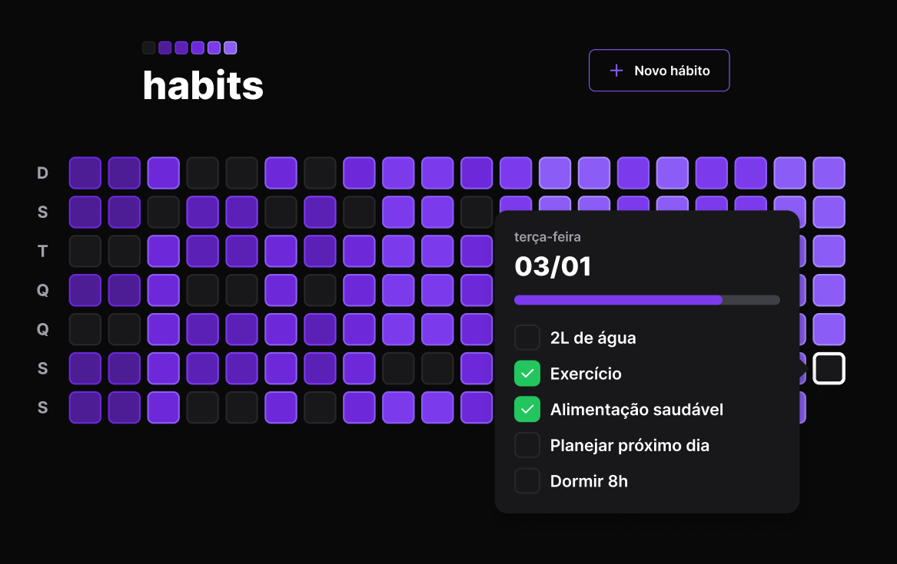
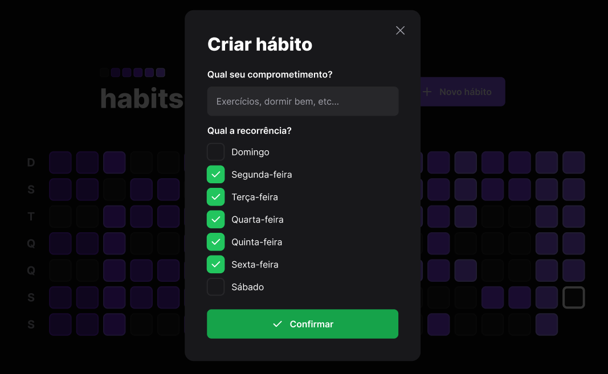
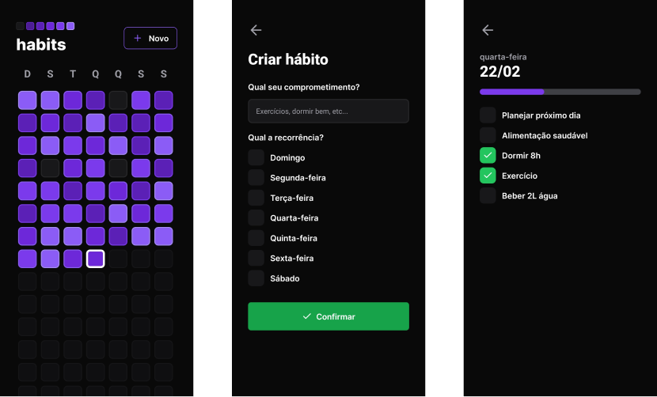

<div align="center">


# habits

**Rastreador de hábitos com app web, app mobile e uma API compartilhada, feito durante o NLW Setup da Rocketseat.**


</div>

[English](README.md) · **Português**

> [!NOTE]
> Projeto desenvolvido durante a **Next Level Week #11 (NLW Setup)** da [Rocketseat](https://www.rocketseat.com.br/), de 16 a 22 de janeiro de 2023, acompanhando as aulas do evento.



---

## Sobre

O usuário cria hábitos, escolhe em quais dias da semana cada um deve acontecer e vai marcando o que cumpriu a cada dia. A tela inicial mostra todos os dias desde o começo do ano como uma grade de quadrados, e cada quadrado fica mais forte conforme mais hábitos daquele dia são concluídos, no estilo do gráfico de contribuições do GitHub.

A mesma API atende dois clientes: um app web em React e um app mobile em React Native.

## Funcionalidades

- **Novo hábito:** título e os dias da semana em que ele se repete.
- **Resumo do ano:** grade com todos os dias desde 1º de janeiro, colorida pelo percentual de hábitos concluídos.
- **Detalhe do dia:** ao clicar num dia (popover no web, tela própria no mobile), aparecem os hábitos daquele dia com barra de progresso e checkboxes.
- **Só o dia de hoje pode ser alterado:** a API só marca hábitos no dia atual, e o app web trava os checkboxes dos dias passados.

<table>
<tr>
<td></td>
<td width="35%"></td>
</tr>
</table>

## Destaques técnicos

- **Resumo numa única query:** a rota `/summary` usa SQL puro (`$queryRaw`) com subqueries para calcular, para cada dia, quantos hábitos eram possíveis e quantos foram concluídos, em vez de carregar tudo e contar no JavaScript.
- **Modelagem relacional:** hábitos, dias, conclusões (tabela pivô `day_habits`) e dias de repetição (`habit_week_days`), com constraints de unicidade para evitar duplicidade. O diagrama é gerado automaticamente pelo `prisma-erd-generator` ([`server/prisma/ERD.svg`](server/prisma/ERD.svg)).
- **Validação com Zod** em todas as entradas da API.
- **Mesma identidade visual no web e no mobile:** Tailwind no web e NativeWind (Tailwind para React Native) no mobile.
- **Componentes acessíveis** no web com Radix UI (Dialog, Popover e Checkbox).

## Stack

| Camada | Tecnologias |
|---|---|
| API | Node.js, Fastify, Prisma, SQLite, Zod, Day.js |
| Web | React, Vite, Tailwind CSS, Radix UI, Axios |
| Mobile | React Native, Expo, NativeWind, React Navigation |

## Rotas

| Método | Rota | Descrição |
|---|---|---|
| `POST` | `/habits` | Cria um hábito com seus dias da semana |
| `GET` | `/day?date=` | Hábitos possíveis e concluídos em um dia |
| `PATCH` | `/habits/:id/toggle` | Marca ou desmarca um hábito no dia atual |
| `GET` | `/summary` | Percentual de conclusão de todos os dias com registro |

## Rodando localmente

Pré-requisitos: Node.js 18+. Para o mobile, o app Expo Go no celular.

```bash
git clone https://github.com/giobroliatto/habits.git
cd habits

# API (http://localhost:3333)
cd server
npm install
echo 'DATABASE_URL="file:./dev.db"' > .env
npx prisma migrate dev
npm run dev

# Web (em outro terminal)
cd web
npm install
npm run dev

# Mobile (em outro terminal)
cd mobile
npm install
npx expo start
```

> No mobile, troque o `baseURL` em [`mobile/src/lib/axios.ts`](mobile/src/lib/axios.ts) pelo IP da sua máquina na rede local.

## Estrutura

```
server/   # API Fastify + Prisma (schema, migrations, seed e ERD)
web/      # App React com Vite
mobile/   # App React Native com Expo
```

---

## Autor

Feito por **Giovani Broliatto** durante o NLW Setup, com as aulas da [Rocketseat](https://www.rocketseat.com.br/).

[](https://www.linkedin.com/in/giobroliatto/)
